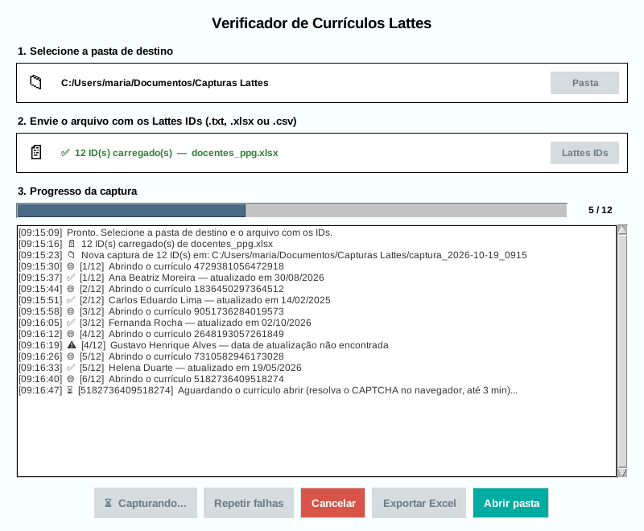

# LattesINK

[](https://github.com/MatheusEstatistico/LattesINK/actions/workflows/ci.yml)
[](https://github.com/MatheusEstatistico/LattesINK/releases/latest)
[](LICENSE)

Verificador de currículos Lattes para fins acadêmicos. A partir de uma lista de IDs, o LattesINK abre cada currículo no Chrome e registra:

- o nome do pesquisador;
- a data da última atualização;
- um print da página, com data e hora.

No fim, ele gera uma planilha Excel com tudo e destaca os currículos sem atualização há mais de um ano.



> O LattesINK não é um produto oficial do CNPq nem da Plataforma Lattes. Ele não contorna o CAPTCHA: cada currículo é aberto no navegador, como se a pessoa o abrisse, e o CAPTCHA é resolvido por quem está usando o programa.

## Download

Baixe a versão mais recente na página de [Releases](https://github.com/MatheusEstatistico/LattesINK/releases/latest):

| Sistema | Arquivo |
| --- | --- |
| Windows 10 e 11 | `LattesINK-X.Y.Z-windows-x64.exe` |
| Ubuntu 22.04+, Debian 12+, Linux Mint 21+ e derivados | `lattesink_X.Y.Z_amd64.deb` |
| Outras distribuições Linux (glibc 2.35 ou mais nova) | `LattesINK-X.Y.Z-linux-x86_64.tar.gz` |

É preciso ter o [Google Chrome](https://www.google.com/chrome/) instalado. Sem ele, o Selenium baixa uma versão de testes do Chrome na primeira captura.

No Windows, o `.exe` não precisa de instalação: é só abrir.

No Linux, instale o `.deb` com:

```
sudo apt install ./lattesink_X.Y.Z_amd64.deb
```

Depois, abra o LattesINK pelo menu de aplicativos ou com o comando `lattesink`.

### Antivírus

É comum que antivírus apontem falso positivo em programas gerados com o PyInstaller, como este. Se isso acontecer, dá para autorizar o arquivo nas configurações do antivírus. No Microsoft Defender, também dá para enviar o arquivo para análise no [portal de envio da Microsoft](https://www.microsoft.com/en-us/wdsi/filesubmission).

Para conferir se o arquivo baixado é exatamente o publicado, compare o hash dele com o do `SHA256SUMS.txt` da release:

```
# Windows (PowerShell)
Get-FileHash .\LattesINK-X.Y.Z-windows-x64.exe

# Linux
sha256sum -c SHA256SUMS.txt --ignore-missing
```

## Como usar

1. **Pasta de destino**: escolha onde os resultados serão salvos. O programa lembra a última pasta usada.
2. **Arquivo com os IDs**: escolha um `.txt`, `.csv` ou `.xlsx` com os IDs Lattes.
3. **Iniciar Captura**: o Chrome abre o primeiro currículo. Resolva o CAPTCHA ("Não sou um robô") e o programa cuida do resto, um currículo de cada vez. Cada CAPTCHA pode levar até 3 minutos.

### O arquivo de IDs

- **`.txt`**: um ID por linha. Vale o ID puro (16 dígitos) ou o link (`http://lattes.cnpq.br/1234567890123456`). Vários IDs na mesma linha também são aceitos.
- **`.csv` e `.xlsx`**: o programa mostra as colunas de todas as abas e já seleciona a que tem mais IDs válidos.
- Antes de começar, o programa avisa quantos IDs estão repetidos e quais valores não são IDs.

> **Atenção ao Excel:** formate a coluna dos IDs como **Texto** antes de digitar ou colar. Como número, o Excel guarda só 15 dígitos e troca o último dígito do ID por zero, e o programa abriria o currículo errado. O LattesINK avisa quando encontra uma coluna assim.

### Durante a captura

- **Cancelar** fecha o navegador. Depois, **Continuar** retoma de onde parou, na mesma pasta.
- Se 3 currículos seguidos não abrirem, a captura é **pausada** automaticamente. Isso acontece, por exemplo, quando ninguém está resolvendo os CAPTCHAs ou quando o site está fora do ar.
- **Repetir falhas** captura de novo só os currículos que não deram certo.
- **Abrir pasta** abre a pasta com os resultados.

## O que é gerado

Cada captura cria uma subpasta nova dentro da pasta de destino:

```
captura_2026-10-19_0915/
├── dados_lattes.xlsx   planilha com um currículo por linha
├── dados_lattes.csv    cópia de segurança, gravada a cada currículo
├── log.txt             mensagens da captura, com data e hora
└── 1234567890123456.png  print de cada currículo, com data e hora
```

A planilha tem uma linha por currículo, com estas colunas:

- link do currículo e ID;
- nome do pesquisador;
- data da última atualização e dias desde então;
- status e observação;
- link para o print;
- data e hora da captura.

Ela já vem com filtros, a primeira linha fixa e a impressão configurada em paisagem. As datas de atualização com mais de 365 dias ficam destacadas em vermelho.

O CSV usa `;` e UTF-8 com BOM, para abrir direto no Excel em português. Se o programa for interrompido no meio, os dados capturados até ali continuam nele.

| Status | Significado |
| --- | --- |
| OK | Currículo aberto e data de atualização encontrada. |
| Data não encontrada | O currículo abriu, mas sem a linha "Última atualização do currículo em...". |
| CAPTCHA não resolvido | O currículo não abriu dentro do tempo limite (3 minutos). |
| Página inesperada | A página não mostrou nem o currículo nem o CAPTCHA (por exemplo, ID inexistente ou erro do site). O título e o começo do texto da página ficam na coluna Observação. |
| Erro | Outro problema (página que não carrega, navegador fechado...). O motivo fica na coluna Observação. |

## CAPTCHA e Extrator Lattes

Este aplicativo não passa sozinho pelo reCAPTCHA, então quem usa precisa resolvê-lo. Quem tem acesso ao [Extrator Lattes](https://www.gov.br/pt-br/servicos/obter-acesso-ao-extrator-da-plataforma-lattes), serviço do próprio CNPq, consegue resolver isso de outra forma. O Extrator Lattes foi criado pela [Fábrica de Software da UNIVILLE](https://github.com/FabricadeSoftwareUNIVILLE/ExtratorLattesCNPq).

## Configuração e registro de erros

A última pasta usada fica guardada em `config.json`. Erros inesperados ficam em `lattesink.log`, com os detalhes técnicos; ao relatar um problema, vale anexar esse arquivo. Os dois ficam em:

- Windows: `%APPDATA%\LattesINK\`
- Linux: `~/.config/lattesink/`
- macOS: `~/Library/Application Support/LattesINK/`

## Desenvolvimento

Requer Python 3.10 ou mais novo, com Tkinter (o Python oficial do Windows já vem com ele; no Ubuntu, instale `python3-tk`).

```
python -m pip install -e ".[dev]"
python LattesINK.py
```

O código tem duas partes:

- **`LattesINK.py`**: a janela (Tkinter).
- **`coletor.py`**: todo o resto (leitura dos IDs, navegador, planilha). Não depende da janela e pode ser testado sozinho.

Antes de enviar uma mudança, rode os testes e o lint (o GitHub Actions roda os dois em cada PR, no Windows e no Linux):

```
python -m pytest        # no Linux sem interface gráfica: xvfb-run -a python -m pytest
ruff check .
```

### Gerar o executável

```
python -m pip install ".[build]"
pyinstaller --noconfirm LattesINK.spec
```

No Windows, o resultado é o `dist/LattesINK.exe`. No Linux, é a pasta `dist/LattesINK/`, que vira um pacote com `bash packaging/linux/build_deb.sh`. Rode o build num ambiente virtual limpo: pacotes instalados por acaso podem acabar dentro do executável. O ícone vem de `assets/icone.png` (veja [assets/README.md](assets/README.md)).

O workflow **Build** do GitHub Actions faz isso a cada PR, e os arquivos ficam em "Artifacts", na página da execução. Assim dá para testar o executável de um PR antes de fazer o merge.

### Publicar uma versão

Tudo pode ser feito pelo site do GitHub:

1. Em `LattesINK.py`, mude `__version__` para a nova versão (por exemplo, `"1.1.0"`).
2. No `CHANGELOG.md`, troque `## [Não lançado]` pela versão e a data (por exemplo, `## [1.1.0] - 2026-11-03`).
3. Faça o commit na `main`.
4. Em [Releases](https://github.com/MatheusEstatistico/LattesINK/releases), clique em **Draft a new release**:
   - em **Choose a tag**, digite `v1.1.0` e escolha **Create new tag**;
   - use o título `LattesINK 1.1.0`;
   - a descrição pode ficar em branco: nesse caso, o workflow usa a seção da versão no `CHANGELOG.md`;
   - clique em **Publish release**.
5. Em alguns minutos, o workflow **Build** anexa à release o `.exe`, o `.deb`, o `.tar.gz` e o `SHA256SUMS.txt`, depois de conferir cada executável. Se a tag não bater com a `__version__`, ele falha com um aviso e não anexa nada.

## Como citar

Se o LattesINK ajudou no seu trabalho, use o botão **"Cite this repository"**, na lateral da página do repositório. Os dados vêm do [`CITATION.cff`](CITATION.cff).

## Licença

O LattesINK é software livre, distribuído sob a [GPL-3.0](LICENSE). Foi criado para fins acadêmicos, sem propósito comercial.
